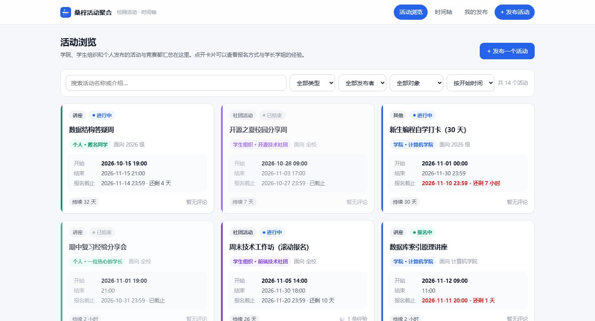
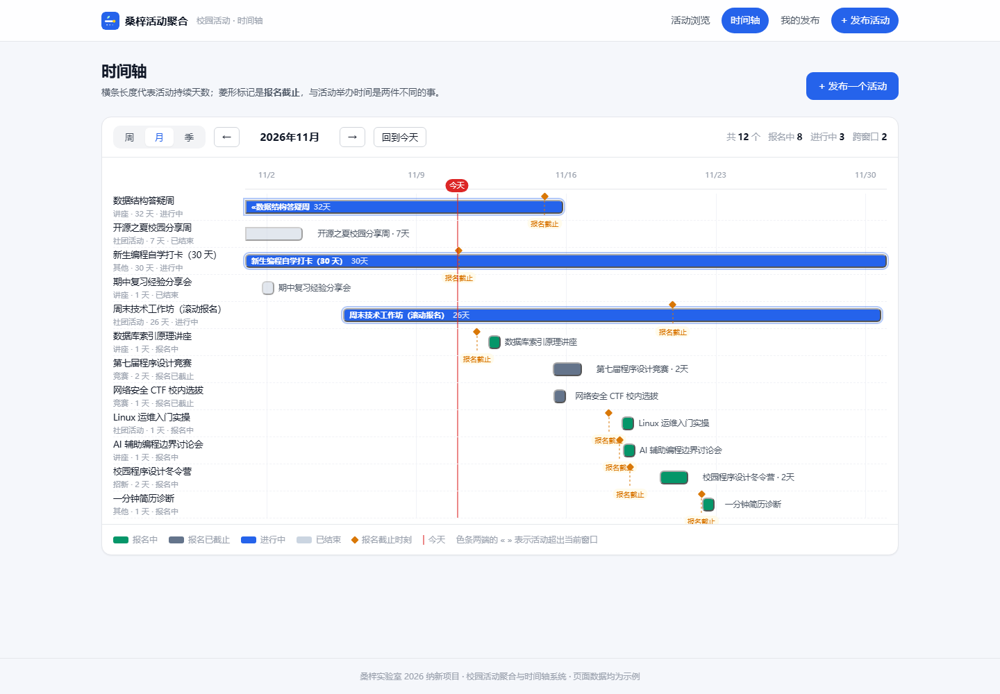

# 桑梓 · 校园活动聚合与时间轴系统

> 桑梓实验室 2026 纳新项目 · **运维方向**
> 把分散在公众号、QQ 群、微信群里的校园活动信息聚合到一处，**以时间为主轴**呈现，并允许同学在活动下沉淀报名经验。



---

## 1. 项目目标

学院、学生组织和同学个人都在发布活动信息，但信息散落在公众号、QQ 群和微信群里。想知道一个活动哪天开始、哪天截止报名、要注意什么，往往要翻好几个地方。

本项目把这些信息集中起来：

- **聚合**：三类发布者（学院 / 学生组织 / 个人）的信息进入同一个池子
- **按时间查看**：横向时间轴同时表达「活动持续区间」与「报名截止时刻」两件不同的事
- **交流**：活动详情下可以补充报名经验、材料要求、注意事项

> 页面中的所有数据均为**自编示例数据**，不含任何真实同学信息。

---

## 2. 功能清单

### 基础要求（全部完成）

| # | 功能 | 实现要点 |
|---|---|---|
| 1 | 活动浏览与详情 | 卡片展示名称/类型/发布者/开始/结束/报名截止；发布者类型有独立配色徽标；详情含介绍、参与方式、外部链接 |
| 2 | **时间轴** | 横向甘特条：色条长度 ∝ 持续天数；**报名截止以菱形标记单独呈现**，与色条形状刻意区分；支持周/月/季切换、今天基准线、图例 |
| 3 | 活动发布 | 9 个字段的完整表单 + 实时校验 + 服务端二次校验；身份直接下拉选择，无需注册 |
| 4 | 搜索与筛选 | 关键词搜索（标题+介绍）+ 活动类型 + 发布者类型 + 面向对象 + 排序，条件可组合、可清空 |
| 5 | 评论与注意事项 | 详情页下方评论区，含昵称/内容/时间，内容非空校验，发表后立即显示 |
| 6 | 数据保存与可用性 | SQLite 持久化（刷新不丢）；所有写操作有 Toast 提示；顶部导航常驻；1440px 与 375px 均可用 |

### 选做（针对运维方向，共 9 项）

| 选做项 | 方向 | 状态 |
|---|---|---|
| 用数据库保存数据（SQLite） | 数据与工程 | ✅ |
| 前后端分离，后端提供 REST 接口 | 数据与工程 | ✅ |
| 数据模型 + 表结构 + 接口设计文档 | 数据与工程 | ✅ [docs/02](docs/02-数据模型与接口设计.md) |
| 活动状态（报名中/进行中/已结束） | 内容管理 | ✅ 由时间**派生计算**，不落库 |
| 测试用例（后端 65 + 前端 14） | 部署与质量 | ✅ [docs/05](docs/05-测试记录.md) |
| Docker 一键启动 | 部署与质量 | ✅ [deploy/](deploy/) |
| 部署脚本（PowerShell / bash） | 部署与质量 | ✅ [scripts/](scripts/) |
| 完善错误提示与边界处理 | 部署与质量 | ✅ 统一错误结构 + 逐字段中文提示 |
| 编辑 / 删除自己发布的活动 | 内容管理 | ✅ 「我的发布」页 |

### 明确不做

真实账号鉴权、学校接口对接、真实通知推送、报名名单收集、正式上线部署——任务书已声明这些不需要，或属于边界禁止项。

---

## 3. 技术方案

```
web/     React 19 + Vite 6 + 原生 CSS（设计令牌）   ← 前端 SPA
   │  HTTP  /api/*  (JSON)  ·  开发期 Vite proxy
server/  Node 24 + Express 5 + node:sqlite          ← 后端 API
   │
data/app.db                                          SQLite 单文件
```

### 关键选型与理由

| 选择 | 理由 |
|---|---|
| **前后端分离** | 任务书把「前后端分离 + 后端提供接口」列为重要加分项；也让"数据与工程"方向有东西可讲 |
| **SQLite 而非 MySQL/PostgreSQL** | 单文件、零运维、别人 clone 下来直接跑，符合"不要求买服务器"；同时满足"用数据库保存数据"的加分项 |
| **`node:sqlite` 而非 better-sqlite3** | Node 24 内置模块，**免原生编译**。Windows 上不会因为 node-gyp / VS Build Tools 缺失而安装失败 |
| **Express 5** | 生态最稳、代码量最小、答辩最容易讲清楚 |
| **不用 TypeScript** | 运维方向不需要构建步骤来证明工程能力。**零构建 = `node src/index.js` 直接跑**，减少"跑不起来"的失败模式；类型用 JSDoc 表达 |
| **React + Vite** | 时间轴这类富交互用声明式渲染成本最低；构建产物由后端单端口托管，生产环境只需一个进程 |
| **原生 CSS + 设计令牌** | 不引 UI 框架：包体小、样式完全可控、不做成"套模板"的观感，且 `tokens.css` 本身就是一份视觉规范 |

### 两个核心设计决策

**① 活动状态不落库，由时间派生**

状态完全由 `startAt / endAt / signupDeadline` 与当前时间决定。落库必然随时间推移与实际不一致，而时间轴、倒计时、筛选全都依赖它。同时把状态拆成两个正交维度：

- `status`：生命周期（报名中 / 报名已截止 / 进行中 / 已结束）
- `signupOpen`：能否报名

这样才能表达「**活动已开始，但报名还没截止**」这种合法情况——单一枚举表达不了。

**② 时间轴 = 连续时间坐标，不是月历格子**

用一个 `ratio(t) = (t - W0) / (W1 - W0)` 的线性映射，同时得到色条的 `left/width`（区间）和截止标记的 `left`（时刻）。因为共用同一坐标系，两者永远对齐；且**跨月、跨年自动正确**，不需要按月切格。

所有几何计算集中在纯函数 `web/src/lib/timeline.js`，与渲染解耦，因此边界情况（裁剪、除零、单日塌缩）都能离线单测。

详见 [docs/03-时间轴设计说明.md](docs/03-时间轴设计说明.md)

---

## 4. 快速启动

### 环境要求

- **Node.js ≥ 22.5.0**（需要内置 `node:sqlite`；本项目在 v24.15.0 上验证）
- 不需要数据库服务、不需要 Docker（Docker 为可选的第三种启动方式）

### 三步启动

```bash
# 1. 安装依赖（后端 + 前端）
npm run setup

# 2. 写入示例数据（14 条活动，覆盖各种时间边界场景）
npm run seed

# 3. 构建前端并启动（单端口 3001）
npm run build
npm start
```

打开 **http://localhost:3001** 即可。

### 三种运行方式

| 方式 | 命令 | 说明 | 验证状态 |
|---|---|---|---|
| **开发模式** | `npm run dev` | 后端 3001 + 前端 5173（热更新），Vite 代理 `/api` | ✅ 已验证 |
| **生产模式** | `npm run build && npm start` | 单端口 3001 同时托管 API 与前端产物 | ✅ 已验证 |
| **容器** | `docker compose -f deploy/docker-compose.yml up -d --build` | 一键启动，数据挂卷 | ⚠️ 见「已知问题」 |

Windows 用户也可以直接用脚本：`scripts\setup.ps1` → `scripts\start.ps1`

### 环境变量

复制 `.env.example` 为 `.env`（可选，不建也能跑）：

| 变量 | 默认值 | 说明 |
|---|---|---|
| `PORT` | `3001` | 后端监听端口 |
| `DB_PATH` | `./data/app.db` | SQLite 文件路径，相对项目根目录解析 |
| `NODE_ENV` | `development` | `production` 时托管 `web/dist` |
| `CORS_ORIGIN` | `http://localhost:5173` | 仅开发期需要；生产同源无需跨域 |

---

## 5. 目录结构

```
.
├─ README.md
├─ package.json              # 统一脚本入口
├─ .env.example
├─ docs/                     # 设计文档（同时是运维方向选交材料）
│  ├─ 00-总体方案与架构.md
│  ├─ 01-需求与功能清单.md
│  ├─ 02-数据模型与接口设计.md
│  ├─ 03-时间轴设计说明.md
│  ├─ 04-部署与质量方案.md
│  ├─ 05-测试记录.md
│  ├─ 06-问题排查记录.md
│  ├─ 07-AI使用记录.md
│  ├─ 08-环境安装清单.md
│  ├─ 09-答辩演示脚本.md      # ← 答辩直接照念
│  └─ screenshots/
├─ server/                   # 后端
│  ├─ src/
│  │  ├─ index.js            # 入口：配置、监听、优雅退出
│  │  ├─ app.js              # Express 装配（可被测试直接引用）
│  │  ├─ db.js               # 连接 + 迁移 + 路径解析
│  │  ├─ schema.sql          # DDL 单一事实来源
│  │  ├─ seed.js             # 示例数据
│  │  ├─ routes/             # activities / meta(health,options,timeline)
│  │  ├─ lib/                # repository / validate / status（纯函数）
│  │  └─ middleware/         # logger / errors
│  └─ test/                  # status / validate / api
├─ web/                      # 前端
│  ├─ src/
│  │  ├─ pages/              # Browse / TimelinePage / Detail / Publish / Manage
│  │  ├─ components/         # ActivityCard / TimelineChart / Comments / ...
│  │  ├─ lib/                # timeline.js（核心算法）/ time.js / labels.js
│  │  ├─ api/client.js
│  │  └─ styles/             # tokens.css（设计令牌）/ base.css
│  └─ dist/                  # 构建产物（不提交）
├─ scripts/                  # dev / verify / setup / start / test
├─ deploy/                   # Dockerfile / docker-compose.yml
└─ .github/workflows/ci.yml
```

---

## 6. 接口一览

Base：`/api`

| 方法 | 路径 | 说明 |
|---|---|---|
| GET | `/api/health` | 健康检查（DB 不可用返回 503） |
| GET | `/api/meta/options` | 枚举字典 |
| GET | `/api/activities` | 列表 + 搜索 + 筛选 + 分页 |
| GET | `/api/activities/:id` | 详情 |
| POST | `/api/activities` | 发布 |
| PATCH | `/api/activities/:id` | 编辑 |
| DELETE | `/api/activities/:id` | 删除（评论级联删除） |
| GET | `/api/activities/:id/comments` | 评论列表 |
| POST | `/api/activities/:id/comments` | 发表评论 |
| GET | `/api/timeline?from=&to=` | 时间窗口内活动 |

统一错误结构：

```json
{ "error": { "code": "VALIDATION_FAILED", "message": "表单校验未通过",
             "fields": { "endAt": "结束时间不能早于开始时间" } } }
```

完整规格见 [docs/02-数据模型与接口设计.md](docs/02-数据模型与接口设计.md)

---

## 7. 时间轴



一个活动在同一视图上表达两件事：

- **活动区间** → 圆角色条，宽度与持续天数成正比；被窗口裁剪时两端显示 `« »`
- **报名截止** → 琥珀色菱形 + 虚线，形状与色条刻意不同，不会被误读为同一件事

左边色条配色代表状态（报名中 / 报名已截止 / 进行中 / 已结束），红色竖线是"今天"。
标注了「跨窗口 N」的活动表示它的时间超出当前视图。

任务书原文样例如下（10-20 截止报名、11-15 至 16 举行），在时间轴上同时可读——该场景有专门的单元测试 `E1 任务书样例`。

---

## 8. 测试

```bash
npm test        # 后端测试（status / validate / api）
npm run verify  # 后端 + 前端 + 构建产物 + 数据库 全量自检
```

| 测试文件 | 数量 | 覆盖 |
|---|---|---|
| `server/test/status.test.js` | 14 | 四态派生、边界时刻、正交状态、非法输入 |
| `server/test/validate.test.js` | 20 | 必填/长度/枚举/时间关系/链接协议/查询参数降级 |
| `server/test/api.test.js` | 31 | 真实起 HTTP 服务，覆盖 P0 全链路 + 安全头 |
| `web/src/lib/timeline.test.js` | 14 | 坐标线性性、裁剪、跨月、除零、排序、刻度自适应 |
| `web/src/lib/time.test.js` | 23 | 日期格式化、区间压缩、时长取整、截止倒计时、表单值互转 |
| `web/src/api/client.test.js` | 15 | 查询串拼装、请求方法、422/404/网络异常 → ApiError 映射 |
| `web/src/lib/myPublish.test.js` | 11 | localStorage 增删查、去重、脏数据与不可写场景的降级 |
| **合计** | **128** | |

详细结果见 [docs/05-测试记录.md](docs/05-测试记录.md)

---

## 9. 已知问题

| # | 问题 | 影响 | 处理 |
|---|---|---|---|
| 1 | **Docker 方案未实测通过（环境阻塞，非代码问题）** | `deploy/` 下的镜像构建未经真实 `docker compose up` 验证 | 开发机 Windows 的组件库损坏（`0x800f0915`／`14098`），无法启用「虚拟机平台」，WSL2 与 Docker Desktop 均无法启动。Dockerfile 与 compose 已按多阶段构建 + 数据卷 + healthcheck 编写并逐行审查，但**未经运行验证，因此不声明其通过**。排查全过程见 [docs/06 §P14](docs/06-问题排查记录.md)。**请在正常机器上执行一次 `docker compose -f deploy/docker-compose.yml up -d --build` 后再视为通过** |
| 2 | CI 未真实运行 | `.github/workflows/ci.yml` 只是配置 | 需先 `git init` 并推送到 GitHub 才会触发 |
| 3 | 无公网演示地址 | 只能本地运行 | 任务书允许"提供能按说明在本地启动的项目" |
| 4 | 时间轴在窄屏下需横向滚动 | 375px 下时间轴画布（470px）超出视口，需左右滑动查看完整跨度 | 已在 375px 视口验证：页面本身无横向溢出，只有时间轴区域可横向滚动；列表/详情/发布页完全自适应。截图见 [mobile-timeline.png](docs/screenshots/mobile-timeline.png) |
| 5 | 无账号体系 | 编辑/删除权限边界依赖浏览器 localStorage | 任务书明确允许简化身份；「我的发布」用本地记录划定范围，避免任意删除他人活动 |
| 6 | 表单仅在顶层给出错误摘要 + 字段旁红字，未逐字段做 `aria-describedby` 关联 | 读屏用户需先听摘要，再定位到具体字段 | 已用表单级 `role="alert"` 摘要覆盖主要场景；逐字段关联列为后续改进 |

---

## 10. AI 工具与开源资料使用说明

本项目在需求分析、架构设计、代码实现、调试排错、文档撰写过程中使用了 AI 编程工具辅助。**所有生成内容均经过逐项验证**（单元测试、真实启动、生产模式接口探测、浏览器渲染截图），核心设计与取舍由本人确认。

- 使用了哪些 AI 工具、分别用在哪里：[docs/07-AI使用记录.md](docs/07-AI使用记录.md)
- 第三方依赖：`express`、`react`、`react-dom`、`react-router-dom`、`dayjs`、`vite`、`@vitejs/plugin-react`（均见各 `package.json`）
- 未复制任何他人的完整项目；示例数据全部自编

---

## 11. 提交物对照

| 任务书要求 | 本仓库对应 |
|---|---|
| 可运行的项目 | 本文档第 4 节，三步启动 |
| 源代码 | `server/` + `web/`，不含密码密钥（`.env` 已在 `.gitignore`） |
| README（目标/功能/技术方案/启动/已知问题/AI 使用） | 本文件 |
| 测试记录（≥3 个场景） | [docs/05-测试记录.md](docs/05-测试记录.md)（128 项自动化 + 6 项手工场景） |
| 答辩演示 | **[docs/09-答辩演示脚本.md](docs/09-答辩演示脚本.md)**（9 分钟逐字脚本 + 12 条高频追问答案 + 故障预案） |
